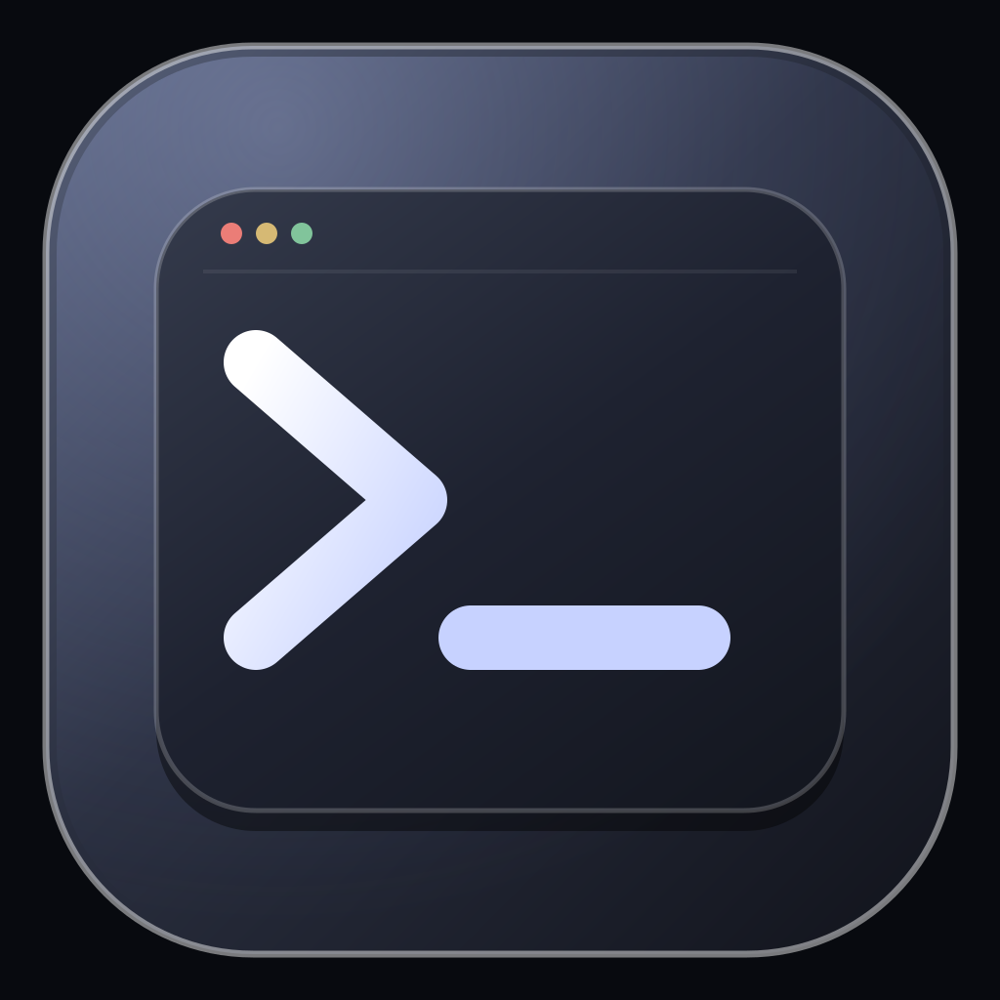

# Makr Terminal



Нативное приложение-терминал для джейлбрейкнутых устройств на iOS 16. Оно открывает настоящую интерактивную shell-сессию через PTY и показывает её в xterm.js, встроенном в локальный WKWebView.

## Что уже есть в первой WIP-сборке

- интерактивная shell-сессия с клавиатурным вводом, историей команд и сигналами `Ctrl+C` / `Ctrl+D`;
- ANSI-цвета, управляющие последовательности, прокрутка до 10 000 строк и изменение размера PTY при повороте экрана;
- кнопки Tab, Esc и стрелок для экранной клавиатуры;
- перезапуск shell-сессии и значок в стиле терминала macOS Sequoia.

Приложение ищет `zsh`, `bash` и `/bin/sh` в системных путях, доступных процессу. Сессия работает от пользователя `mobile` внутри app sandbox; rootless-бинарники за пределами контейнера не подключаются.

## Совместимость

- iOS 16.0 и новее;
- arm64, rootless jailbreak;
- тестовая цель: iPhone 8 с iOS 16.7.16 и Dopamine.

Пакет пока помечен `Section: WIP` и работает в стандартном iOS sandbox. Поэтому shell может быть ограничен контейнером приложения, а некоторые системные пути или команды могут быть недоступны. Полный доступ к файловой системе устройства пока не включён. Команды выполняются от пользователя `mobile`.

## Сборка

Нужны macOS с Xcode, Theos, iOS SDK и `ldid`.

```sh
make clean package FINALPACKAGE=1 THEOS_PACKAGE_SCHEME=rootless
```

Результат появится в `packages/`. GitHub Actions запускает такую же сборку на `main` и загружает `.deb` как артефакт `makr-terminal-deb`.

Для добавления готового пакета в APT-репозиторий положи `.deb` в `MakrSas/repo/debs/`, выполни `./update.sh` и закоммить обновлённые индексы. В поле `Section` пакета уже указано `WIP`.

## Сторонний код

Веб-терминал использует `@xterm/xterm` 6.0.0 и `@xterm/addon-fit` 0.11.0. Их MIT-лицензии приложены в `Resources/Web/vendor/`.
